# ML Workbench — the beginner's manual

This manual assumes you have never trained a model before. It walks through one complete
project from start to finish, using a dataset that ships with the program, and explains
every number you will see along the way.

You do not need to know any Python. You do not need to know any statistics. You do need
about twenty minutes.

> **The short version.** Open the program. Click **Load the example project (customer
> churn)** on the first screen. Go to **5 · Model**, set *target column* to `churned`,
> press **Train the model**. Go to **7 · Evaluate** and read the numbers. That is the
> whole workflow. The rest of this manual explains what just happened and how to make it
> better.
>
> **If you came for a number rather than a prediction** — is this batch different, how
> strong will it be at 28 days, what is the chance it misses the specification — the six
> screens in [section 6](#6-the-engineering-toolkit) answer those directly.

---

## Contents

1. [What this program is for](#1-what-this-program-is-for)
2. [Getting it running](#2-getting-it-running)
3. [The five-minute tour](#3-the-five-minute-tour)
4. [The example project, step by step](#4-the-example-project-step-by-step)
   - [4.1 · Load the data](#41--load-the-data)
   - [4.2 · Explore](#42--explore)
   - [4.3 · Clean](#43--clean)
   - [4.4 · Prepare features](#44--prepare-features)
   - [4.5 · Model](#45--model)
   - [4.6 · Tune](#46--tune)
   - [4.7 · Evaluate](#47--evaluate)
   - [4.8 · Save & export](#48--save--export)
   - [4.9 · Predict](#49--predict)
   - [4.10 · Best combinations](#410--best-combinations)
   - [4.11 · Cluster & project](#411--cluster--project)
   - [4.12 · Graphs](#412--graphs)
   - [4.13 · Run everything](#413--run-everything)
5. [Deep learning](#5-deep-learning)
6. [The engineering toolkit](#6-the-engineering-toolkit)
   - [6.1 · Two more example projects](#61--two-more-example-projects)
   - [6.2 · Tests and statistics](#62--tests-and-statistics)
   - [6.3 · Curve fitting](#63--curve-fitting)
   - [6.4 · Design of experiments](#64--design-of-experiments)
   - [6.5 · Time series and control charts](#65--time-series-and-control-charts)
   - [6.6 · Units and constants](#66--units-and-constants)
   - [6.7 · Uncertainty and reliability](#67--uncertainty-and-reliability)
   - [6.8 · Excel and Word](#68--excel-and-word)
7. [What the numbers mean](#7-what-the-numbers-mean)
8. [Where your files go](#8-where-your-files-go)
9. [When something goes wrong](#9-when-something-goes-wrong)
10. [Where to go next](#10-where-to-go-next)

---

## 1. What this program is for

"Machine learning" here means one specific and very common job: **you have a table of
data with one column you care about, and you want to predict that column for rows where
you do not know it.**

Your table might be:

| customer_id | region | plan     | tenure_months | monthly_charge | churned |
|-------------|--------|----------|---------------|----------------|---------|
| C-00001     | North  | Standard | 10            | 60.89          | no      |
| C-00002     | South  | Standard | 51            | 50.81          | no      |
| C-00003     | South  | Premium  | 64            | 104.33         | yes     |

The column you care about is `churned`. You want to look at a *new* customer and say
"this one is likely to leave". That is all. The program calls the column you care about
the **target** and everything else the **features**.

Depending on what is in your target column, the job has a different name:

| Your target looks like | The job is called | An example |
|---|---|---|
| Numbers you measure | **Regression** | predict a house price, a temperature, a strength |
| Two options | **Binary classification** | churn: yes/no, spam: true/false |
| Three or more options | **Multiclass classification** | which of five species is this? |
| Nothing — you just want groups | **Unsupervised** | find the natural segments in my customers |

The program works out which one you have by looking at the column. You can correct it if
it guesses wrong.

Everything else in the workbench exists to answer one of four questions:

- **Is my data usable?** (screens 1–4)
- **How good is my model, honestly?** (screens 5–9)
- **What is actually driving the prediction?** (screens 10–12)
- **What is the number the design review is asking for?** (screens 13–18 — the engineering
  toolkit, which works on a plain table with no model at all if that is all you need)

---

## 2. Getting it running

### Start the program

Open a terminal in the project folder and run:

```sh
cd "ML Workbench DL"
./.venv/bin/python app.py
```

You can also drag a data file onto the window, or start with one already loaded:

```sh
./.venv/bin/python app.py --data "examples/customer_churn.csv"
```

### If you have to install it from scratch

The folder ships with its own Python environment in `.venv`, so normally there is
nothing to install. If it is missing, rebuild it with **two** commands, in this order:

```sh
python3.14 -m venv .venv
.venv/bin/pip install -r requirements.txt
.venv/bin/pip install -r requirements-dl.txt
```

The second file is separate on purpose: it points at PyTorch's CPU-only download index,
and mixing it into the first command would misdirect the ordinary packages to the wrong
server.

### The window

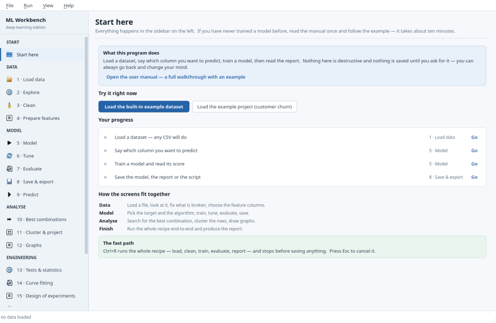

On the left is a list of nineteen screens in six groups. **Start** is where you begin;
**Data**, **Model**, **Analyse** and **Finish** are the order you normally work in, and
**Engineering** holds the six toolkit screens — ignore that group entirely until you want
one of the questions in [section 6](#6-the-engineering-toolkit) answered. The bar along the
bottom always tells you what is loaded and what is running.

If you open a screen before it can do anything — **7 · Evaluate** before you have trained
a model, for instance — it says so at the top and offers a button to take you where you
need to go. No screen is ever silently useless.

**F11** (or **View → Full screen**) fills the whole display with the program, and **F11**
again puts the window back the way it was. A screen with more on it than fits — the
feature-engineering form is a long one — scrolls; nothing is ever squeezed or cut off to
make it fit.

---

## 3. The five-minute tour

If you would rather see the whole thing work before reading anything, do this:

1. On the **Start here** screen, click **Load the built-in example dataset**. A 900-row
   table of concrete mixes appears in **1 · Load data**.
2. Press **Ctrl+R**. That runs the entire workflow — split, compare algorithms, tune the
   winner, fit it, draw graphs, write a model, a report and a script.
3. Watch the bottom bar for progress. Press **Esc** to stop it.
4. Go to **7 · Evaluate** and look at the numbers. Then go to **8 · Save & export** and
   click **Open the report**.

That is the whole program. Everything below is the same thing, done deliberately, with
an explanation of each decision.

---

## 4. The example project, step by step

### The scenario

You are a data analyst at a subscription company. The company loses customers every
month and would like to know **which customers are about to leave**, so the retention
team can call them first. You have an export from the billing system.

The file is `examples/customer_churn.csv` — 4,000 customers, ten columns. It is synthetic
but built to be awkward in the ways real exports are awkward, so that the screens have
something to do.

### 4.1 · Load the data

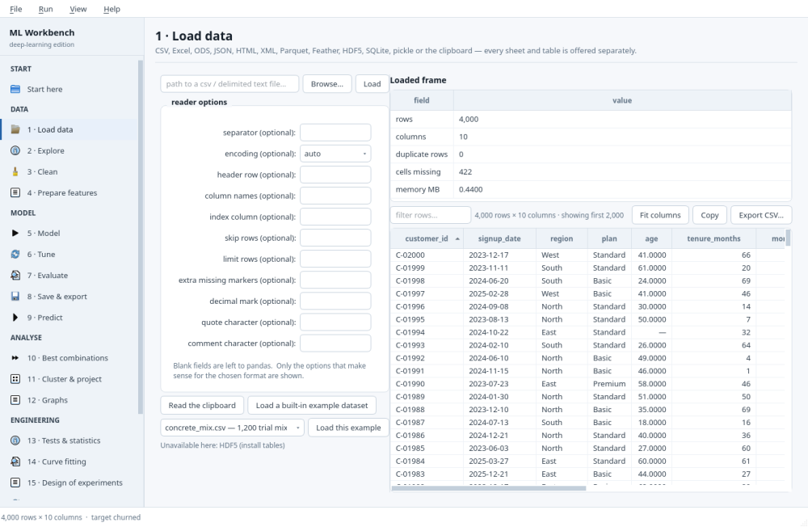

**Do this.** Click **Load the example project (customer churn)** on the *Start here*
screen — or open **1 · Load data**, choose the format, browse to
`examples/customer_churn.csv`, and press **Load**.

**What you should see.** On the right, the first rows of the table. Down the left, a
*reader options* box. Every format the program can read is in the dropdown at the top:
CSV and any other delimited text, fixed-width text, Excel and OpenDocument spreadsheets,
JSON, HTML, XML, Parquet, Feather, HDF5, SQLite and other SQL databases, pickle, or
whatever is on your clipboard. If a file has more than one sheet or table, a second
dropdown appears so you can pick one.

**If it goes wrong.** If your file uses semicolons instead of commas, put `;` in
*separator*. If the first row is not the header, set *header row* to `0`. If the file is
Latin-1 and the accents look wrong, set *encoding* to `latin-1`. These options exist so
you never have to edit the file by hand.

> **Why the screen asks for the format at all.** Because a `.txt` file might be anything,
> and a `.csv` file might really be a tab-separated file with a misleading name. The
> format dropdown is what you actually know; the extension is only a hint.

### 4.2 · Explore

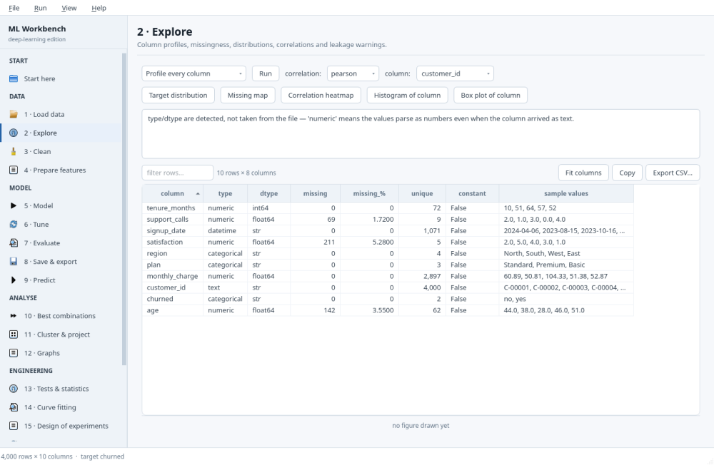

**Do this.** Open **2 · Explore**, leave the analysis on *Profile every column*, and press
**Run**.

**What you should see.** One row per column, with its type, how many values are missing,
how many distinct values it has, and a sample.

This table is the most useful thing in the program, so read it carefully. Looking at the
example:

| column | what the profile tells you |
|---|---|
| `customer_id` | 4,000 unique values in 4,000 rows — this is an identifier, not information |
| `signup_date` | type `datetime`, 1,071 unique values — a date, which the model cannot use as-is |
| `region`, `plan` | 4 and 3 distinct values — these are categories |
| `age`, `tenure_months`, `monthly_charge` | numeric, no missing values |
| `support_calls`, `satisfaction` | numeric, but **69 and 211 values are missing** |
| `churned` | 2 distinct values — this is the target |

**The other buttons** answer other questions. *Missing map* draws where the holes are.
*Correlation heatmap* shows which numeric columns move together. *Target distribution*
shows whether your target is balanced. Try *Missing map* now and look at the picture.

> **The one rule worth internalising.** A column that is unique per row (`customer_id`)
> or that encodes time in a way the model cannot use (`signup_date`) will either be
> ignored or actively mislead the model. Drop it. The program drops obviously useless
> columns automatically, but you should know they are there.

### 4.3 · Clean

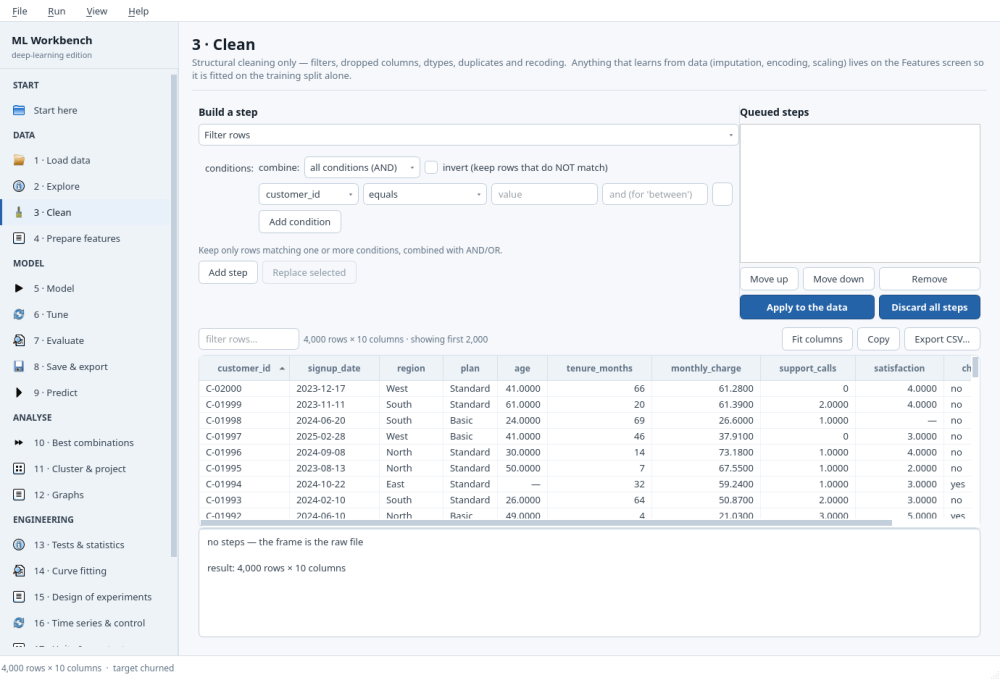

**Do this.** This screen is optional for the example — the program handles the missing
values on the next screen. But do one thing to see how it works: choose **Drop columns**
from the dropdown, tick `customer_id` and `signup_date`, and press **Add step**, then
**Apply to the data**.

**What you should see.** The table shrinks from ten columns to eight. The queued step
appears on the right, where you can reorder or remove it before applying.

There are twelve operations: filter rows, drop columns, keep only these columns, rename a
column, change a type, drop duplicate rows, drop rows with missing values, replace a
value, bulk-replace many values, clamp or winsorise outliers, sort, and reset the index.

**Important — what belongs here and what does not.** This screen does *structural*
cleaning: things that are true of the data itself, that you would do the same way for
any model. Imputation, encoding categories, and scaling do **not** belong here, because
they have to be learned from the training data only. They live on the next screen. If you
impute a missing value here using the average of the whole file, you have leaked
information from the test set into your model and your scores will be quietly optimistic.

> **Every step here is logged and replayable.** The **13 · Run everything** screen and
> the exported script both re-run this exact recipe, so cleaning is not a thing you did
> once and forgot.

### 4.4 · Prepare features

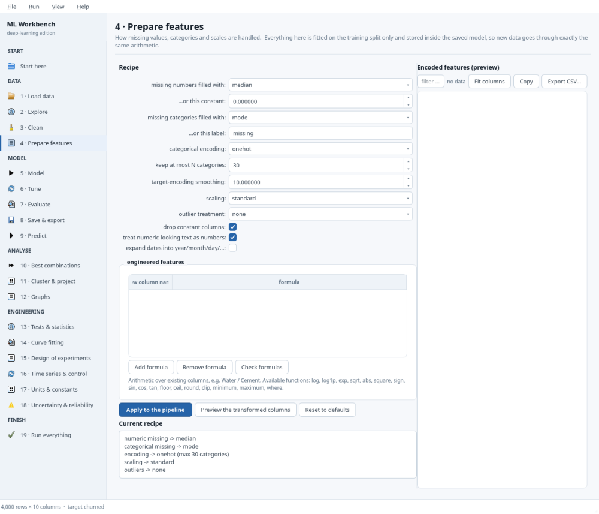

**Do this.** Look at the settings, then leave them alone. The defaults are good.

**What you should see.** Choices for how missing values are filled, how categories are
turned into numbers, and whether to rescale. You can also add a formula column — type
something like `monthly_charge / tenure_months` and it becomes a new feature.

**Why this screen exists.** A model is arithmetic, so every input must be a number. Your
table has `region = "North"`, which is not a number. This screen turns it into numbers —
by default, one yes/no column per category (`region=North`, `region=South`, …). Missing
numbers get filled in. Numeric columns get put on a comparable scale.

**The one thing to notice.** Everything on this screen is *learned from the training
rows only* and then stored inside the saved model. When you later score a new customer,
the same averages, the same category list and the same scale are applied. This is why
predictions from the saved model match the report exactly.

> **Why not just fill missing values with the column average here?** Because then the
> average would include the rows the model is later tested on. The model would have seen
> a whisper of the answers. Keeping it on this screen is what makes the reported score
> trustworthy.

### 4.5 · Model

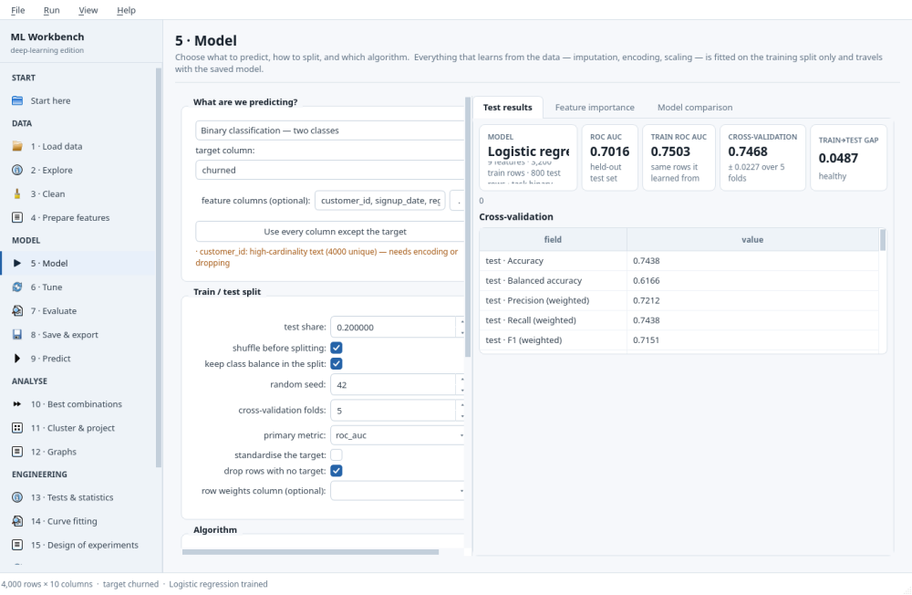

**Do this.**

1. Set **task** to `Binary classification — two classes`. (The program may already have
   guessed this.)
2. Set **target column** to `churned`.
3. Press **Use every column except the target**.
4. Leave the split settings alone.
5. Press **Train the model**.

**What you should see.** The screen splits in two. On the left, the settings. On the
right, a *Test results* tab with the cross-validation score, and tabs for *Feature
importance* and *Model comparison*.

**The settings, and what they mean**

| setting | what it does | what to do |
|---|---|---|
| **task** | what kind of prediction this is | let the program guess, then check it |
| **target column** | the column you want to predict | `churned` |
| **feature columns** | which columns may be used as inputs | all of them |
| **test share** | the fraction held back to score the model | leave at 0.2 — 20% |
| **shuffle before splitting** | randomise the row order first | leave on |
| **keep class balance in the split** | keep the yes/no ratio the same in both halves | turn **on** for classification |
| **random seed** | makes the split reproducible | leave at 42 |
| **cross-validation folds** | how many times the data is re-split for a more reliable score | leave at 5 |
| **primary metric** | the number you want to optimise | ROC AUC for a yes/no target |
| **standardise the target** | rescale a numeric target internally | regression only |
| **row weights column** | give some rows more influence | leave blank |

**What happened when you pressed the button.** The program:

1. split your 4,000 rows into 3,200 for training and 800 held back for testing;
2. fitted the imputation, encoding and scaling on the 3,200 training rows only;
3. trained the chosen algorithm on those rows;
4. scored the result on the 800 rows the model has never seen.

That last point is the whole reason the number you are about to read is worth anything.

**Now compare algorithms.** Switch to the **Model comparison** tab and press the button
there. It cross-validates a handful of different algorithms on the training rows and shows
the scores side by side. On this dataset you should see roughly:

| model | ROC AUC (cross-validated) |
|---|---|
| Logistic regression | 0.75 |
| Random forest | 0.77 |
| XGBoost | 0.76 |
| LightGBM | 0.76 |
| Neural network (MLP) | 0.78 |

Three things to take from that table. First, 0.75–0.78 is a realistic result for a churn
problem — real ones live between 0.70 and 0.80, and anyone quoting 0.99 has made a
mistake. Second, the tree models beat plain logistic regression by a couple of points,
which is the usual outcome on a table like this: the signal is not a straight line. Third,
**the network is not automatically the winner** — here it edges ahead by a point, on
another dataset it will lose. That is why you compare instead of guessing.

> **Why is 0.77 not "bad"?** Because churn is genuinely hard to predict. A model at 0.77
> that ranks your customers is worth a great deal of money; a model claiming 0.99 has
> almost always been tested on data it was trained on.
> still sorts your customers usefully: if you call only the highest-risk 10%, you will
> reach far more real leavers than by calling people at random. Section 7 explains how to
> read the number properly.

### 4.6 · Tune

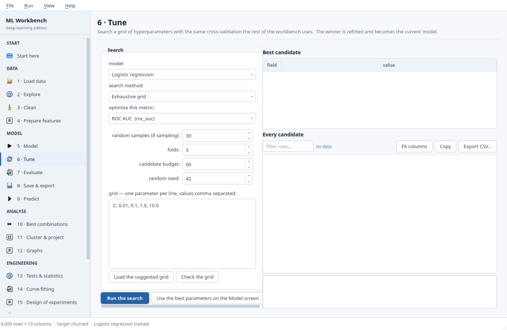

**Do this.** Open **6 · Tune**, keep the model you just chose, and press **Run the
search**.

**What you should see.** A list of candidate settings, each scored by cross-validation,
with the best one marked. The winner is refitted and becomes your current model.

**What it is doing.** Every algorithm has *hyperparameters* — knobs that are not learned
from data. How many trees? How deep? How fast should it learn? The screen tries each
combination you list, scores it with the same five-fold cross-validation the rest of the
program uses, and keeps the winner.

**Warning, and it is a real one.** This is the slowest screen in the program, because it
is genuinely training the model many times. A search over six settings with five folds
means thirty fits. The progress bar and the **Cancel** button both work; press **Esc** to
stop.

> **A trap worth avoiding.** If you tune on the same split you then report your score
> from, your score is no longer honest — you have chosen the settings that happen to suit
> those 800 rows. The program refits the winner and re-scores it, but the honest way to
> use a tuned model is to check it once on data you have not touched. Keep a copy of your
> data aside for exactly that, or trust the cross-validation score more than the test
> score when they disagree.

### 4.7 · Evaluate

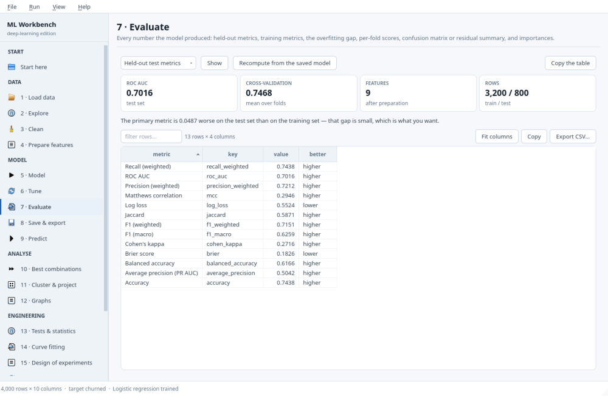

**Do this.** Open **7 · Evaluate** and read down the page.

**What you should see.** Four numbers at the top, then a sentence in plain English, then a
full table of every metric the model produced.

On the example you should see something close to:

| card | value | what it means |
|---|---|---|
| **ROC AUC** | 0.7016 | how well it *ranks* customers by risk, on rows it has never seen |
| **Cross-validation** | 0.7468 | the same thing averaged over five different splits |
| **Features** | 9 | how many input columns the model actually used |
| **Rows** | 3,200 / 800 | training rows / held-back rows |

(The **5 · Model** screen shows a slightly different set — the same score on the training
rows and the *gap* between the two. That gap is the next paragraph.)

**The most useful thing on this screen is the sentence.** It compares the score on the
training rows with the score on the held-back rows and tells you what the gap means:

> *"The primary metric is 0.0487 worse on the test set than on the training set — that gap
> is small, which is what you want."*

The gap is the important part. A **small** gap means the model learned the pattern. A
**large** one means it has **overfitted** — it memorised the training rows instead of
learning the pattern, and its good training score is worthless. The cure is usually fewer
or simpler settings, more data, or a stronger penalty — try **6 · Tune** with a smaller
search, or pick a simpler algorithm.

**Switch the view** to see other things:

- *Confusion matrix* — how many of each class it got right and wrong, and in which
  direction. For churn, this is where you see whether it misses leavers or invents them.
- *Per-fold scores* — the five individual cross-validation results. If they disagree
  wildly, your data is small or uneven and you should trust the average less.
- *Feature importance* — which columns the model leaned on. You should see `tenure_months`
  and `support_calls` near the top on this dataset.

> **Look at feature importance every single time.** If a column you know is meaningless
> (`customer_id`, a row number, a date) shows up at the top, your model has found a
> shortcut and its score is a lie. This is the single most common way a beginner's model
> looks good and is useless.

### 4.8 · Save & export

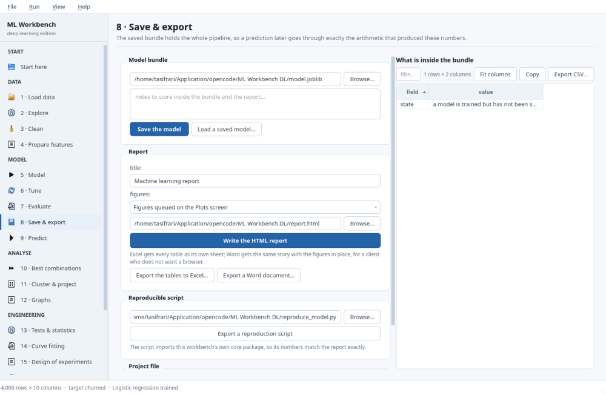

**Do this.** Press **Save the model**, then **Write the HTML report**, then **Export a
reproduction script**.

**What you should see.** Three files written, each with a confirmation. The defaults are:

| file | what it is |
|---|---|
| `model.joblib` | the entire pipeline — cleaning recipe, imputation, encoding, scaling and the trained model |
| `report.html` | a self-contained web page with the metrics, the tables and the figures |
| `reproduce_model.py` | a Python script that re-runs the whole thing and prints the same numbers |

**Why the bundle matters.** A saved model that is only the trained algorithm is useless,
because the new data would not go through the same imputation and encoding. This bundle
holds the whole chain, which is why a prediction from it matches the report exactly.

**The report** is the thing to send to someone. Open it in a browser — it has the
metrics, the plots you queued on **12 · Graphs**, the settings, and the library versions.

**The script** is the thing to keep for yourself. Run it later and it reproduces the
result from scratch:

```sh
./.venv/bin/python reproduce_model.py
```

> **A `.mlproj` file is also available** in the *Project file* box. It saves the whole
> session — which file, which cleaning steps, which settings — so you can reopen the
> project tomorrow and carry on. Use **Save a .mlproj project…** before you close the
> window on anything you care about.

### 4.9 · Predict

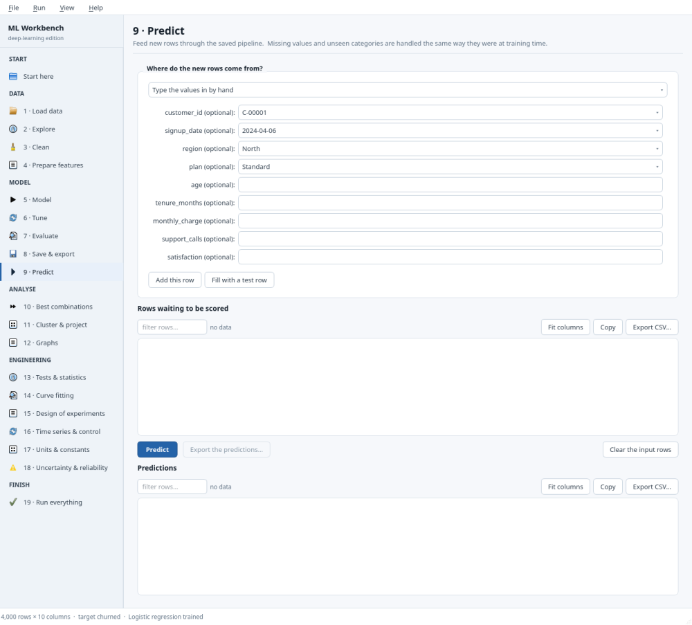

**Do this.** Open **9 · Predict** and press the button to score rows.

**What you should see.** Your held-back rows with a new `prediction` column, and for a
classification problem a probability column as well. You can copy the result or export it
as CSV.

**Two things this screen can do.** It can score the rows the model was tested on, so you
can eyeball where it went wrong. Or you can paste in a raw table with the same columns as
the original file, and it will push those through the saved pipeline — missing values and
unseen categories included.

> **Test it with a row you understand.** Take the row with the lowest probability and the
> row with the highest, and check that the reasons make sense. If the highest-risk
> customer has `tenure_months = 70` and `satisfaction = 5`, something is wrong — go back
> and look at feature importance.

### 4.10 · Best combinations

This screen asks four different questions. They are easy to confuse, so here is the
difference:

| question on screen | plain English |
|---|---|
| **Best value per field** | holding everything else still, which value of *this* column moves the prediction most? |
| **Inverse design** | I want a prediction of *this* value — what inputs would produce it? |
| **Best cleaning recipe** | which of these cleaning recipes scores best? |
| **Best feature combination** | which subset of my columns scores best? |

The first two are about understanding a model you have. The last two are searches that
try many alternatives and score each one, so they are slow; they also *adopt* their
winner into your current settings, so go back to **5 · Model** afterwards and look at
what changed.

> **Use inverse design with care.** It answers "what inputs give this output", which is
> not the same as "what should I do". If it says a 70-month tenure predicts retention,
> you cannot give a customer 70 months of tenure. It is a way to understand the model, not
> a way to make decisions.

### 4.11 · Cluster & project

Unsupervised work: no target, no right answer. Two uses.

**Clustering** groups rows that behave alike — k-means, DBSCAN, or hierarchical. Use it
to find customer segments you did not know existed. The screen reports a **silhouette**
score; higher means the groups are more clearly separated. On the example, three or four
clusters is a reasonable guess.

**Projection** compresses many columns into two or three so you can plot them: PCA, t-SNE,
or the autoencoder from the deep-learning section. This is how you look at a
twelve-dimensional dataset on a flat screen.

> **Do not feed a cluster label back in as a feature without thinking.** If the clustering
> used the same rows you are training on, the label contains a summary of the target for
> those rows, and your score will jump in a way that will not survive contact with new
> data.

### 4.12 · Graphs

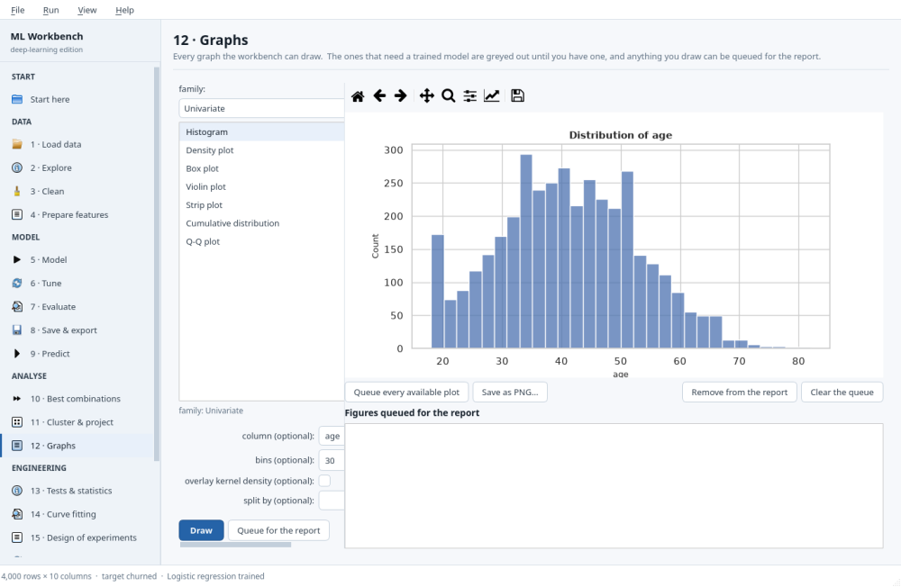

Forty-five graphs, from histograms to ROC curves. Graphs that need a trained model are
greyed out until you have one — hover over a greyed entry and it tells you what it needs.

Pick one, press **Draw**, then press **Queue for the report** on anything worth keeping.
Queued figures are embedded into the HTML report from **8 · Save & export**.

### 4.13 · Run everything

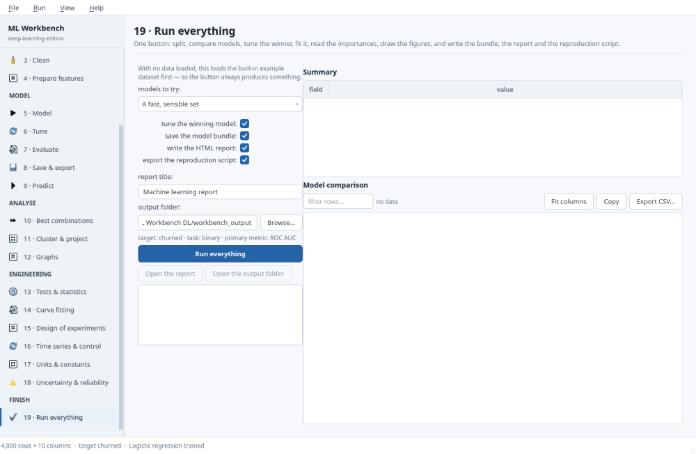

One button that does the lot: split, compare models, tune the winner, fit it, read the
importances, draw figures, and write the model, the report and the script. Choose an
output folder, press **Run everything**, and watch the progress bar.

It is the fastest way to get a first result on a new dataset. It is also the least
considered — it picks the algorithm for you and you learn nothing about your data along
the way. Use it to see whether a dataset is promising, then go back and do it properly.

> **It will not pick a neural network for you.** On a small table, a boosted tree almost
> always wins, so the automatic run stops there. Networks are chosen deliberately — see
> the next section.

---

## 5. Deep learning

This copy of the workbench adds three neural networks, in PyTorch, running on the CPU.

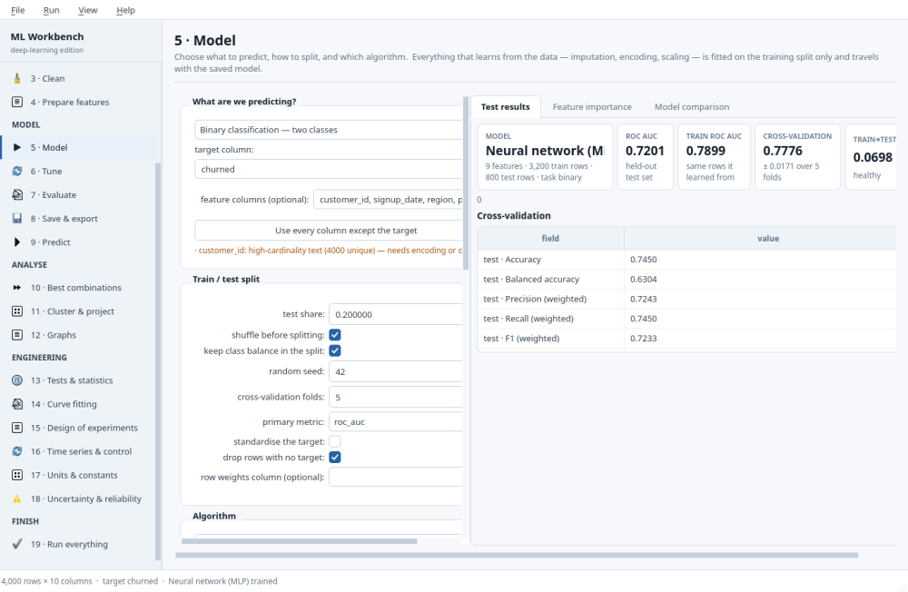

| network | use it for | how to pick it |
|---|---|---|
| **Neural network (MLP)** | regression, binary and multiclass | *Model* screen, algorithm = *Neural network (MLP)*; it adapts to the task you chose |
| **Autoencoder** | clustering, and finding anomalies | *Cluster & project*, algorithm = *Autoencoder* |

### When a network is worth trying

Honestly? Less often than you would think. On a table with a few thousand rows and a
dozen columns, a boosted tree is usually as good and much faster. A network earns its
place when:

- your table is **large** — tens of thousands of rows or more;
- you have **many categorical columns with many levels** (the network learns an embedding
  for each one, which is often better than one-hot columns);
- the relationships are **strongly non-linear** and you have enough data to learn them.

On the example project, the network scores about 0.72 ROC AUC — right alongside the trees
(the picture above shows 0.7214 on the held-out rows and 0.78 averaged over five
cross-validation folds). That is the honest answer: no magic, just a different way of
drawing the boundary.

### What makes this network different

**It reads your categories as embeddings.** When the program sees a group of one-hot
columns that came from one categorical column, it replaces them with a small learned
vector instead. On the example, `region` and `plan` become two small tables of numbers
that the network trains alongside everything else. This is the main reason to prefer a
network on wide categorical data.

**It is small and it is bounded.** Four threads, a shallow network, and a hard time limit
per fit, so it behaves on a laptop without a graphics card. The **About** box shows the
exact configuration.

### The settings that matter

| setting | what it does | sensible value |
|---|---|---|
| **hidden layers** | the shape of the network | `64, 32` for most tables |
| **epochs** | how many passes over the data | leave at 120 |
| **patience** | stop if the validation score stops improving for this many epochs | leave at 12 |
| **learning rate** | how big each correction is | 0.001 is a safe default |
| **batch size** | how many rows per correction | 64 |
| **max seconds** | a hard ceiling on one fit | raise it if the network is still improving when it stops |

### Reading a network's results

Two extra graphs appear once a network has been trained:

- **Training curve** — loss against epoch, for the training and validation sets. This is
  the single most informative picture in deep learning. If the training line keeps falling
  while the validation line turns upward, the network is memorising. If both are flat and
  high, it is not learning — raise the learning rate or add capacity.
- **Reconstruction error** — only for the autoencoder. It shows how badly each row is
  rebuilt from the compressed version; rows with the largest error are the odd ones out.

**Cancelling.** Training a network is long by design. The **Cancel** button and **Esc**
both interrupt it cleanly — the run stops at the end of the current epoch, not after all
of them.

---

## 6. The engineering toolkit

Everything up to here predicts a column from other columns. That is only half of what a
civil engineer is asked to do. The other half arrives as a question with a number in it:

- *Are these two batches actually different, or is the difference just scatter?*
- *How strong will this mix be at 28 days if I have only tested it at 7?*
- *What is the chance a batch falls below the specification?*
- *Is the pile still settling, or has it stopped?*
- *How many tests do I need before I can trust the answer?*

Screens **13** to **18** answer those directly, so that none of them needs a script of
your own. They all live in the **Engineering** group in the sidebar. None of them is
required — if you only ever want a prediction, screens 1–12 are the whole program.

> **Two habits before you use any of these.** Say what you expect *before* you look, so
> that "it came out significant" means something. And always report the interval, not
> just the estimate — a settlement rate of 3.6 mm/year is a different sentence from
> 3.6 mm/year, give or take 0.2.

### 6.1 · Two more example projects

The manual's main walk-through uses customer churn, because it is a table anyone can
read. The toolkit is easier to follow on engineering data, so two more example files ship
beside it. To load one: go to **1 · Load data**, and pick it in the box under the
buttons — the file names are listed there with a one-line description of each.

| file | what it is |
|---|---|
| `concrete_mix.csv` | 1,200 trial mixes: cement, slag, fly ash, water, admixtures, aggregates, curing method and age, with the measured cube strength. Also a `meets_C30_37` column — `yes` when the cube made 37 MPa — so the same file works as a regression *and* as a yes/no problem. |
| `pile_settlement_monitoring.csv` | One instrumented pile, 157 weekly readings over three years: settlement, applied load, pore pressure, groundwater level and the construction stage. Three gauges failed to read. |

Both files are real in the sense that matters: every number was generated from a physical
relationship, seeded so it never changes, and the awkward parts (an id column, a date
column, missing readings, a specification limit) are the parts you meet in practice.

### 6.2 · Tests and statistics

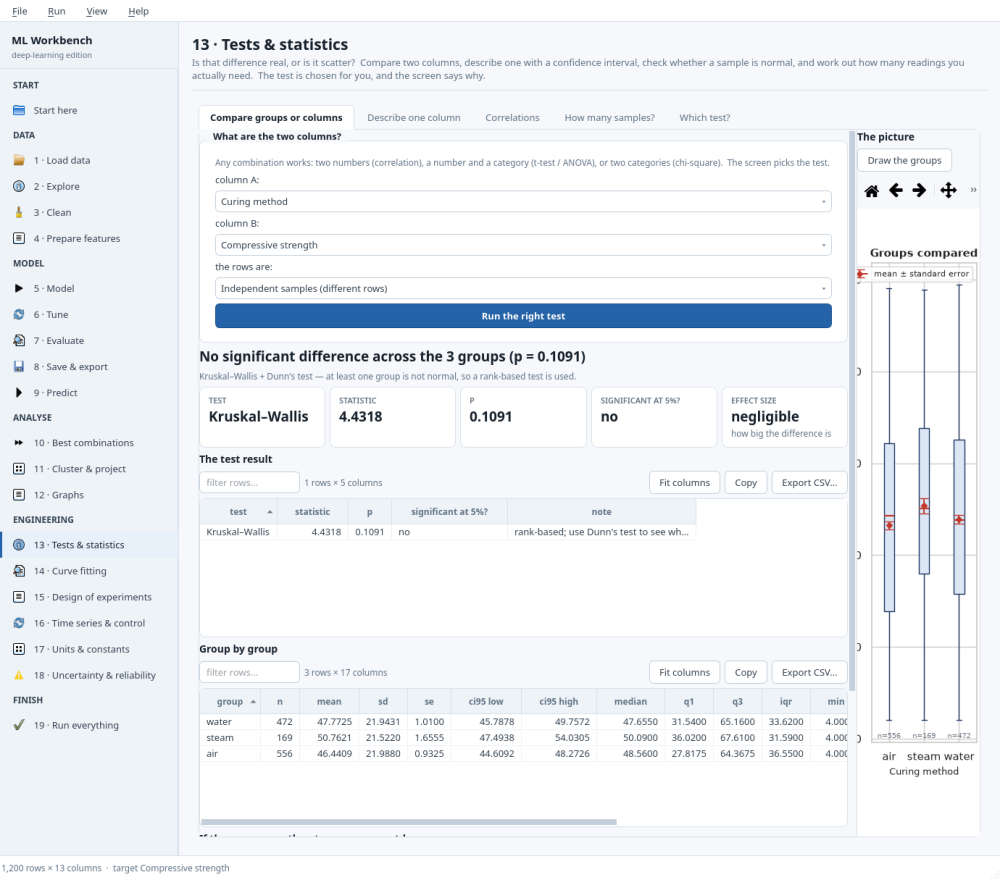

Five tabs, and the first three are the ones you will use.

**Compare groups or columns** is the tab to open when you have two columns and want to
know whether they are related. Pick the two columns and the program decides what the
question is and which test answers it:

- two numeric columns → a correlation;
- one numeric, one with words in it → a comparison of group means, with the right test
  chosen for you (a *t*-test when the groups are roughly normal, otherwise Mann–Whitney
  or Kruskal–Wallis, which do not assume a bell curve);
- the same column twice, measured before and after → a paired test, which is far more
  sensitive because each sample is its own control.

On the concrete mixes, `Cement` against `Compressive strength` gives **r = 0.44** over
1,200 batches — a moderate positive relationship, and unsurprising: cement is what makes
concrete strong. Comparing strength across the three curing methods gives **p = 0.11**
— *no significant difference*. Do not read that as "curing does not matter". It means
that with this much batch-to-batch scatter, three methods cannot be told apart; if you
need to know, that is an experiment to design (see [6.4](#64--design-of-experiments)),
not a statistical test to run harder.

The result panel always shows the effect size as well as the p-value, because a p-value
on its own says nothing about whether the difference is big enough to care about.

**Describe one column** gives the summary you would otherwise compute by hand: mean,
standard deviation, standard error, a 95% confidence interval for the mean, median,
quartiles, range, coefficient of variation, skewness and kurtosis — plus two normality
tests and a test for a single outlier. Read the confidence interval, not the mean.

**Correlations** shows a whole matrix at once, and, underneath it, every pair ranked by
strength with the two column names beside each number.

**How many samples?** turns "I want to be able to detect a difference of half a standard
deviation, with 80 % power" into a number: **32 per group**, for that example. Run it
*before* you order the testing.

**Which test?** is the reference card: it lists the situation and the test, so you can
see why the program chose what it chose.

### 6.3 · Curve fitting

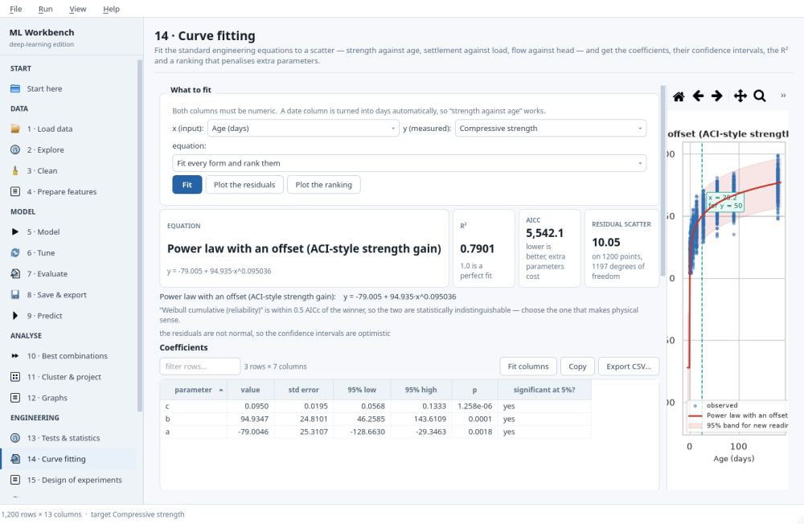

The screen for the relationship that is written down as a formula: strength against age,
settlement against load, flow against head, fatigue life against stress range.

Choose the column for *x* and the column for *y*, then either fit one named form or press
**Fit every form and rank them**. Thirteen forms are offered — straight line, quadratic,
cubic, power law, logarithmic, exponential growth and decay, reciprocal, hyperbolic,
logistic and Gompertz S-curves, a Weibull cumulative, and the offset power law that
strength-gain test results actually follow.

On the concrete mixes, age against strength ranks the **offset power law** first, at
**R² = 0.79** — the classic strength-gain curve, here fitted as
`y = −79.0 + 94.9·x^0.095`. Read the equation, not just R²: a negative intercept on a
strength curve is the fitting telling you the form is a shape, not a mechanism.

The same tab also does the two things you would otherwise put in a spreadsheet:

- **Solve for x.** "What age gives 50 MPa?" — type `50` and press Solve, and you get the
  age, with a prediction interval, rather than reading it off a graph.
- **Interpolate a table.** List the x values you need (`21, 35, 200`) and it fills in y.
  Values outside the range you actually tested are flagged as **extrapolated** — the
  program will show them, but it will not pretend they are measurements. A real trial
  report repeats its ages (1, 3, 7, 14, 28, 56, 90 and 180 days, over and over), so the
  readings at each age are averaged first: on this file, 1,192 repeated ages collapse onto
  the 8 ages the lab actually tested.

### 6.4 · Design of experiments

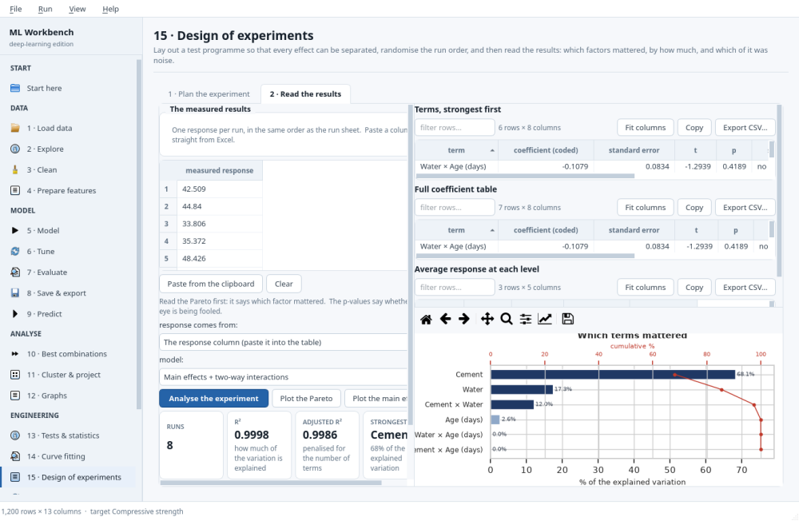

This is the screen that stops you wasting a month of testing. Instead of changing one
thing at a time, you choose the factors and their two (or three) levels, and the program
lays out a *set* of runs that tells you about every factor and their interactions at
once, in as few runs as possible.

Seven designs are offered: full factorial (every combination — 8 runs for three factors
at two levels), fractional factorial (for screening many factors cheaply), central
composite and Box–Behnken (when you expect a curved response — a maximum, not a slope),
and Latin hypercube, Sobol and Halton sequences for filling a space when each "run" is a
simulation rather than a test.

The first tab produces the **run sheet**: the factors, the runs in randomised order with
the standard order beside them (so you can find your place in the lab notebook), and a
blank response column. Press **Copy the run sheet** and paste it into the workbook you
take to the lab.

When the results come back, fill the response column in and the second tab fits the
effects, ranks them by how much of the variation each one explains, and draws a Pareto
chart — the shortest possible list of things that matter. It reports the *aliases* too:
in a fractional design some effects are tangled up with others, and the program will not
let you forget which ones.

> **This screen does not invent your results.** The picture above is the *read the results*
> tab of a finished eight-run experiment — its responses were produced by the example model
> so that you can see what the output looks like before you have run anything. On a real
> job that tab stays empty until you paste your own measurements in.

### 6.5 · Time series and control charts

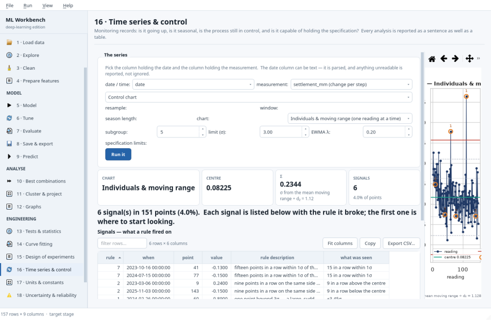

For readings taken in order over time — settlement, groundwater, deflection, temperature,
a daily strength from the batching plant. Choose the date column and the measurement
column and then one of nine analyses:

| analysis | the question it answers |
|---|---|
| **Trend** | is it rising, falling or flat, and by how much per year? Gives the slope with a confidence interval and a Mann–Kendall test, which does not assume the rise is a straight line. |
| **Seasonality** | does the value depend on the month? |
| **Resample** | put an irregular record onto a daily, weekly or monthly calendar. |
| **Moving average** | smooth the noise so the shape is visible. |
| **Autocorrelation** | are neighbouring readings related? If they are, a plain regression on this data is overconfident. |
| **Decompose** | split the record into trend, season and what is left over. |
| **Control chart** | has something changed? See below. |
| **Process capability** | Cp and Cpk against a specification — the number a precast yard is asked for. |
| **Gaps** | where the readings are missing, and whether the cadence has changed. |

The pile record shows a rise of **+3.65 mm/year** (95 % confidence interval 3.44 to 3.85,
p < 0.001) — about 10.9 mm over the three years. That is a real settlement, not noise.

**Now the important part.** If you put that rising total on a control chart, the chart raises
**163 signals across its 154 points** — almost every reading breaks one rule or another,
because the limits are drawn from the spread of the series, and on a rising series the
spread *is* the trend. A chart like that tells you nothing at all.

The fix is the one a monitoring engineer already knows: chart the **change from one
reading to the next**, not the running total. **Add these lag and rolling columns to the
dataset** (the button under the chart settings) will make that column for you —
`settlement_mm (change per step)` — through the cleaning pipeline, so it survives saving
and reopening the project. Chart *that* column and the story becomes clear:

- the pile's normal weekly movement is +0.08 mm, with a standard deviation of 0.23 mm;
- **the week ending 31 March 2025 moved +1.32 mm — 5.3 standard deviations** — and the
  extra millimetre stayed. Something happened that week;
- two other weeks are flagged at about 3.4σ, which is what happens once in a long record.
  That is why the chart lists the rule each point broke rather than just saying
  "out of control".

Run the capability analysis on the weekly movement against a ±0.5 mm/week criterion —
the sort of limit a monitoring specification actually sets — and it reports
**Cpk = 0.58: not capable**, with about 5 % of weeks expected to exceed the limit.

Four charts are offered: individuals, X-bar and R (for readings grouped into batches),
CUSUM and EWMA. CUSUM and EWMA are the two that find a *small, sustained* shift, which a
single point beyond the limit does not.

### 6.6 · Units and constants

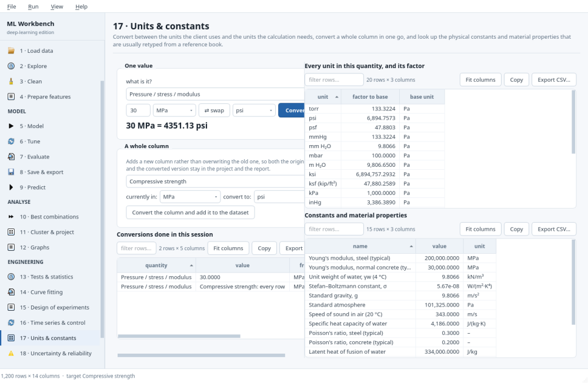

Twenty-four quantities — length, area, volume, mass, force, pressure and stress, moment,
density, unit weight, velocity, flow, rainfall intensity, energy, power, temperature and
the rest — with an ordinary two-column conversion, **30 MPa = 4,351.13 psi**, and a table
of the factors if you want to see where the number came from.

Below that, a **convert a whole column** tool. It is the one control on these six screens
that changes your data, so it says so on the button and it goes through the cleaning
pipeline: the new column is recorded as a cleaning step, so it reappears when the project
is reopened, and it can be removed from **3 · Clean** like any other step.

Temperature is handled separately and deliberately: 0 °C is not 0 °F, so an offset scale
cannot be applied by multiplying a column, and the screen refuses rather than quietly
getting it wrong.

The screen also lists the physical constants and material properties people retype from
reference books — the ones that produce a wrong answer when a digit is mistyped.

### 6.7 · Uncertainty and reliability

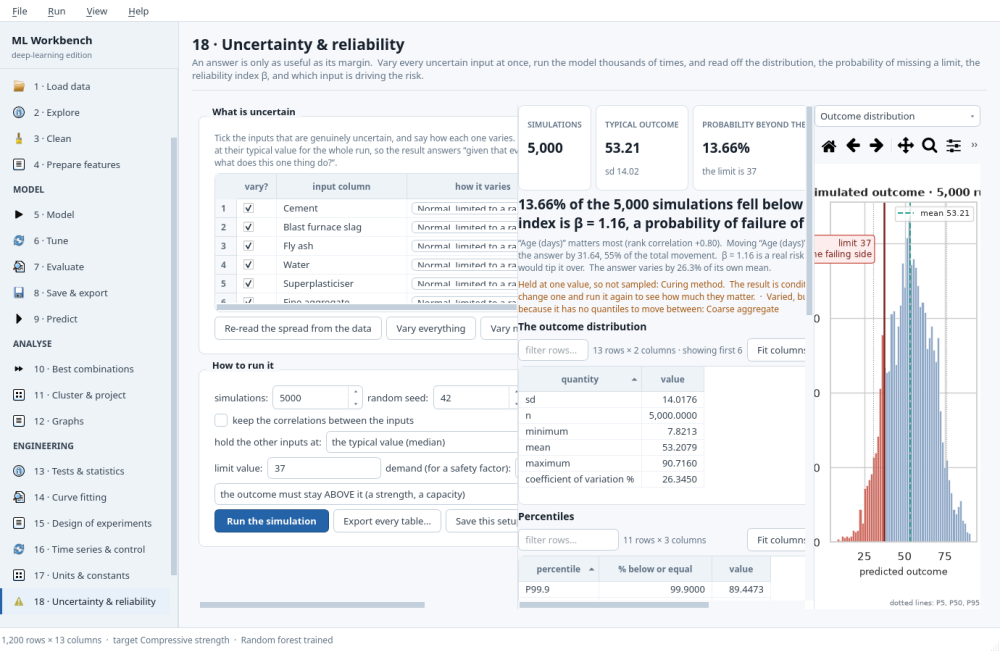

This is the screen for the question a design review actually asks: *how likely is it that
this fails?* It answers it by running the model thousands of times, each time with the
inputs drawn from their real scatter.

It needs a trained model first, because it uses the model as the thing being tested. Then:

1. the input grid is filled in from the model's own features, with a distribution guessed
   from the data — normal, lognormal for positive skewed quantities, triangular or PERT
   for a three-point estimate, or simply resample the observed values;
2. tick which inputs should vary and edit any distribution you disagree with;
3. type the **limit value** — the strength the mix has to reach, the settlement the
   structure can take — and say whether falling below or rising above it is the failure;
4. press **Run the simulation**.

On the concrete mixes, with a model built from the nine mix variables (cement, slag, fly
ash, water, superplasticiser, both aggregates, age and curing method), the inputs drawn
from their observed scatter, and a limit of 37 MPa, the model puts the **probability of
falling below the specification at about 14 %** — reliability index β ≈ 1.1 — and names
**Age (days)** as the input the answer moves with most. That is a number you can put in a
design review, along with the sensitivity chart that says which measurement is worth
improving.

Give it a second number, a **demand**, and it also reports the distribution of the safety
factor (resistance ÷ demand), and the probability that the factor drops below 1.

Two honest limitations are stated on the screen rather than hidden. The simulation is only
as good as the model and the distributions you gave it. And a column of *names* — a curing
method, a supplier — cannot be sampled from a curve, so it is held at one value and the
screen says so; change the value in the box and run it again to see what that category is
worth.

Every view here can be sent to the report, and the whole setup can be saved to a small
text file, so a colleague can reproduce the run rather than take your word for it.

### 6.8 · Excel and Word

Everything the engineering screens produce — the statistics tables, the fitted
parameters, the experiment analysis, the control-chart violations, the Monte-Carlo
percentiles and influence ranking — is queued into the same report as the model results.
Two more buttons on **8 · Save & export** put it into the two formats a client asks for:

- **Export the tables to Excel** writes one formatted sheet per table, plus a first
  "Notes" sheet that says where the workbook came from.
- **Export the report to Word** writes a `.docx` with the headings, the paragraphs, the
  tables and the charts in it, ready to be edited into a letter.

Both are built from the same tables you are looking at, so what you send is what you saw.

---

## 7. What the numbers mean

You will see these on **7 · Evaluate**. Here is what each one actually tells you, in the
order you should care about them.

### For a yes/no target (binary classification)

**ROC AUC** — if you pick one leaver and one stayer at random, how often does the model
give the leaver the higher risk? 0.5 is a coin toss, 1.0 is perfect.
*Good: 0.70–0.80 is a genuinely useful model. Above 0.95 on a hard real problem usually
means a leak.*

**Accuracy** — the fraction it got right. *Careful: misleading when one class is rare.
Ignore it if your classes are uneven.*

**Balanced accuracy** — accuracy with both classes counted equally. *Use this instead of
accuracy whenever one class is rarer than the other.*

**Precision** — of the customers it flagged, how many really left? *High precision means
few false alarms.*

**Recall** — of the customers who really left, how many did it catch? *High recall means
few missed leavers.*

**F1** — one number balancing precision and recall. *Use it when you need a single score.*

**MCC** — a balanced score that only looks good if all four cells of the confusion matrix
look good. *Anything above 0 beats guessing.*

**Log loss and Brier score** — how well *calibrated* the probabilities are, not just how
well they rank. *Lower is better, and this only matters if you act on the probability
itself rather than on the ranking.*

> **Precision and recall trade off against each other.** You can catch every leaver by
> calling everyone (recall 100%, precision terrible). You can be certain by calling almost
> nobody. Which you want is a business decision, not a statistical one — decide what a
> missed leaver costs versus a wasted phone call.

### For a numeric target (regression)

**R²** — the fraction of the variation in the target the model explains. 1.0 is perfect,
0 means "no better than always guessing the average", and negative means worse than that.
*What counts as good depends entirely on the problem; 0.6 can be excellent.*

**RMSE** — the typical error, in the units of your target, punishing big misses hardest.
*Compare it to the spread of your target.*

**MAE** — the typical error, in the units of your target, treating all misses equally.
*Often the easier one to explain to someone else.*

**MAPE and sMAPE** — the error as a percentage. *Only meaningful when the target never
comes near zero.*

> **Always compare RMSE to the spread of your target.** An RMSE of 5 sounds fine for house
> prices and terrible for a person's height. The target distribution on **2 · Explore**
> tells you the spread.

### About the two scores you will see

**Cross-validation** re-splits the data five times and averages the result. It is the more
reliable number, because it does not depend on one lucky split.

**Held-out test** is a single split. It is the number to report, because it is the one the
model genuinely never saw — but it is noisier.

When they disagree, believe the cross-validation number and investigate the split.

---

## 8. Where your files go

Everything defaults to the project folder, and every path is editable before you press the
button.

| file | default | what it is |
|---|---|---|
| model bundle | `model.joblib` | the whole pipeline, ready to score new data |
| report | `report.html` | the self-contained report to share |
| script | `reproduce_model.py` | re-runs the analysis from scratch |
| project | `*.mlproj` | your session, so you can come back to it |
| one-click outputs | `workbench_output/` | everything the automatic run produces |
| exported figures | wherever you save them | PNG files from the Graph screen |
| Excel workbook | `workbench_tables.xlsx` | one sheet per table, for whoever works in Excel |
| Word document | `workbench_report.docx` | the same tables and charts as an editable document |
| manual screenshots | `docs/manual/` | the pictures in this document |

The reproduction script accepts its own options:

```sh
./.venv/bin/python reproduce_model.py --help
```

> **Never delete `.venv`** — it is the Python environment the program runs in. Everything
> else in the folder is either source code or output.

---

## 9. When something goes wrong

**The window opens but a screen is greyed out.**
That screen needs something you have not done yet. The bar at the top of it says what,
and the button takes you there.

**"This screen works on a trained model, and none is trained yet."**
Go to **5 · Model** and press **Train the model**, or press **Ctrl+R**.

**The score looks too good to be true.**
It almost certainly is. In order of likelihood: a column that leaks the answer (a
`customer_id`, an ID, a date, a "status" that is only known after the fact); a cleaning
step applied to the whole file instead of the training split; or the same rows appearing
in both halves of the split. Check **Feature importance** first.

**The score is barely better than guessing.**
That happens, and it is a real result, not a bug. Try: more rows, better columns, or a
different target. A model cannot find a pattern that is not there. Check the *Model
comparison* tab — if every algorithm lands in the same place, the ceiling is the data.

**A tree model scores worse than plain logistic regression.**
Common on small tables. Untuned boosted trees overfit. Go to **6 · Tune** and let the
search reduce the number of trees and the depth.

**The neural network scores worse than the trees.**
Also common, and expected on a few thousand rows. It is not a bug. Use the trees.

**Tuning is taking forever.**
It is genuinely training the model dozens of times. Press **Esc** to stop, then narrow the
grid — one or two settings instead of five.

**`findfont: Failed to find font weight semibold` in the terminal.**
Harmless. It is matplotlib complaining about a font it does not have; the figure is fine.

**`This plugin does not support propagateSizeHints()` in the terminal.**
Harmless. It comes from the desktop platform plugin, not from this program.

**A file will not load.**
Check the format dropdown first, then *separator* and *encoding*. If it is an Excel file
with several sheets, a second dropdown appears — the sheet you want may not be the first.

**"Could not convert string to float."**
You have fed a raw table into something that expects prepared data — usually **9 ·
Predict** or a network. Either run it through **4 · Prepare features** first, or use the
raw-frame path on the Predict screen.

**I closed the window and lost my settings.**
Save a `.mlproj` project on **8 · Save & export** before closing. The program does not
autosave.

---

## 10. Where to go next

Once you have finished the example, the fastest way to learn more is to run the same
screens on your own data. Two habits are worth building from the start:

1. **Look at the profile on 2 · Explore before you touch anything.** Half of all
   modelling mistakes are visible in that one table.
2. **Look at feature importance after every single fit.** It is the cheapest possible
   check that your model is learning something real.

Then, in roughly increasing order of difficulty:

- run **10 · Best combinations → Best feature combination** to find out which columns
  actually earn their place;
- try the same project with a different target, and see how the numbers change;
- use **6 · Tune** properly on one algorithm instead of the automatic run;
- open the exported `reproduce_model.py` and read it — it is ordinary, readable Python and
  it shows exactly what the buttons did;
- work through [section 6](#6-the-engineering-toolkit) on a job of your own — the
  statistics, the experiment design and the reliability screen in particular are the three
  that save the most time.

### The other documents in this folder

| file | who it is for |
|---|---|
| `USER_MANUAL.md` | this file — beginners |
| `DEVELOPER.md` | whoever maintains the program: layout, invariants, the findings log |
| `examples/` | the three example datasets, and `make_examples.py`, which regenerates them |
| `docs/make_manual_shots.py` | regenerates the pictures in this manual |

### Further reading, if you want the theory

- *scikit-learn*'s user guide, at scikit-learn.org — the algorithms in this program are
  the ones documented there.
- *An Introduction to Statistical Learning* (free online) — the standard gentle textbook.
- *Interpretable Machine Learning* by Christoph Molnar (free online) — how to explain what
  a model did, which is what screens 7 and 10 are for.
